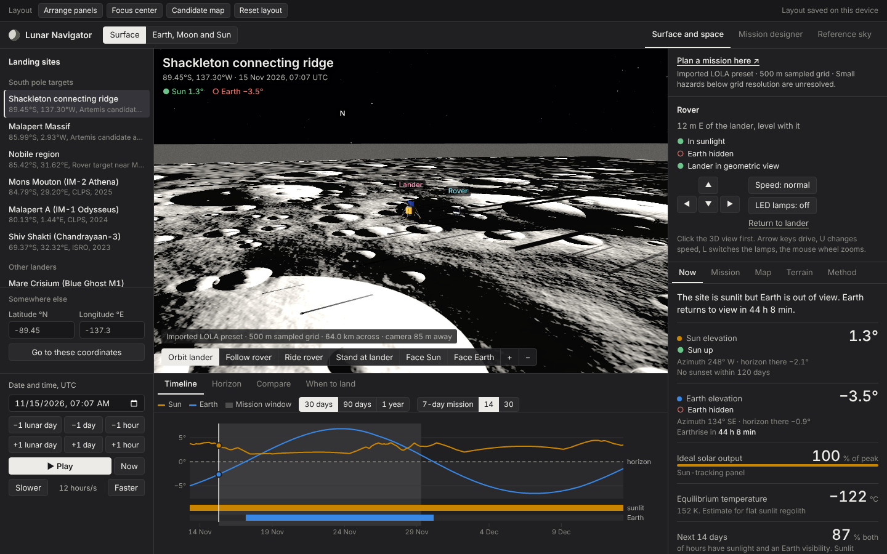

# Lunar Navigator

A browser tool for planning a Moon landing: compare landing sites and dates, stand on the surface in 3D, and screen a mission's orbit and fuel budget.

Built by **Newguys Studios** for the 2026 NASA Space Apps Challenge, "Lunar Landing Site Navigator".

Live site (once GitHub Pages is switched on): https://manharmisra-cyber.github.io/NasaSpaceApps-NewguysStudios/



## Team

| Name | Role |
|---|---|
| Zhian | Backend |
| Vansh | Backend and presentation support |
| Manhar | Formulae and Scientific Validation |
| Ashank | Presentation |
| Siddant | Frontend and 3D models |

## The three pages

| Page | File | What it is for |
|---|---|---|
| Surface and space | `index.html` | Will this site have sunlight and a view of Earth on this date? 3D surface, rover, Earth-Moon-Sun view, timeline, comparison, resource calculator |
| Mission designer | `mission.html` | Can this spacecraft get there? Orbit, fuel and thrust screening, candidate arrival areas, burn planning, 3D terrain |
| Reference sky | `sky.html` | Cached JPL Horizons data for three south-pole viewpoints, used as the accuracy reference |

The pages share one site list and hand the selected place and time to each other: "Plan a mission here" on the surface page opens the mission designer at the same pin and date, and "Explore this location and time" goes back.

## What it does

### Surface and space
- **Sites and dates.** 17 preset sites (south pole targets, recent landers, Apollo), exact custom coordinates, or a click on the Moon. Any UTC date, with step buttons, play, and seven playback speeds.
- **3D surface view.** Real terrain at true scale with a lander and a drivable rover (normal, fast and ultra speed, LED lamps). The Sun and a rotating Earth sit at their computed positions. Large shadows come from a line-of-sight test against the height grid.
- **Space view.** Earth, the Moon and the Sun to scale, with first-person views from Earth, from the landing site and from the Sun, and an illustrative first-person flight from Earth to the Moon.
- **Status.** Sun and Earth elevation, time to the next rise or set, ideal solar output, an equilibrium temperature estimate, and the share of the mission with both sunlight and Earth in view.
- **Timeline, horizon panorama, comparison table** (copy or download as CSV), and **when to land** (date probes ranked with the mission designer's fuel and geometry screening).
- **Resource calculator.** Panel output, battery, power draw, data volume and downlink rate, run hour by hour against the real sunlight and Earth-visibility hours.
- **Candidate arrival map.** Arrival areas from the mission designer drawn on the globe, polar and flat maps.
- **Arrange panels.** Move the site list, 3D view, time dock and inspector to any edge, or focus on one. The layout is saved on the device.

### Mission designer
- Rotate a 3D Moon built from NASA elevation, drop a pin or pick a preset, and choose a search radius.
- Start in lunar orbit or estimate an Earth parking-orbit departure; land on the Moon or move to another lunar orbit, optionally with an inclination change.
- Enter wet and dry mass, thrust, specific impulse, fuel reserve and orbit; get delta-v budgets, candidate arrival tracks and a burn schedule (CSV or JSON).
- **Arrival search for your pin** covers the whole chosen interval (up to 731 days) and finds every pass, including passes shorter than a second, with window edges to 0.0001 s.
- **Crewed missions** check the acceleration the crew feels (thrust divided by mass) against NASA's sustained +Gz limits for Artemis landers (NASA/TM-20205008196), for standing or seated crews with or without a compression garment.
- **Mission check** lists every check as pass, warning, fail, not checked or not applicable, with the value, the limit and a suggested correction. Items the model does not compute, such as the powered descent profile, are never shown as passes.
- **Step-by-step guidance** for each maneuver: trans-lunar injection, lunar orbit insertion, deorbit, terminal braking, Hohmann transfers, circularization, apoapsis and periapsis changes and inclination changes, with burn point, direction, delta-v, duration, propellant, expected result and warnings.
- **Burn planning** stops at usable propellant: a burn that would dip into the reserve is marked infeasible with its shortfall, and later burns are marked not reached.
- Play arrival areas forward in time.
- Regional terrain viewer: 100 to 1,000 km areas with imagery, elevation colours or wireframe, at true scale or exaggerated.

### Reference sky
- Hourly JPL Horizons Sun and Earth positions for November 2026 at three polar viewpoints, with a panorama, a horizon chart, month comparison, horizon-profile CSV import and CSV export.

## Project layout

```
index.html, css/, js/, data/     surface and space page (css/style.css is the shared look; css/merge.css styles the linked features)
mission.html, mission*.mjs, burn-plan.mjs, candidate-map.mjs, globe.mjs, terrain-*.mjs, *.css
                                 mission designer and its terrain views (css/theme.css gives it the shared look)
sky.html, app.js, data.js, sky-time.js, horizons-*.txt
                                 reference sky and the cached JPL Horizons responses
lunar-sites.js, shared-state.js, mission-context.mjs
                                 the site list and the place/time hand-off shared by all pages
assets/terrain/                  global Moon mesh and elevation tiles for the mission designer
vendor/                          three.js (used by the mission designer's terrain views)
tests/                           numerical and data checks
tools/                           scripts that built data/ from the NASA files
server.mjs                       optional local server
```

## Tests

```
node tests/run.js
node --test tests/*.mjs
```

They cover the arrival search (including a brute-force one-second cross-check), crew acceleration limits, maneuver guidance, the mission check, burn planning and agreement between them, as well as the astronomy (Meeus worked examples, the Apollo 11 landing Sun elevation, and JPL Horizons comparisons: largest difference 0.034 degrees across three sites and five dates, and 0.036 degrees across 4,326 cached hourly directions), the terrain, horizon, shadow and line-of-sight code, vehicle placement on terrain, the orbit and burn calculations, time playback, data integrity and the hand-off between pages.

## Data and sources

- **Elevation:** NASA LRO LOLA. 500 m grids around the 17 preset sites (from the 64 px/deg product), far-horizon profiles out to 400 km, and the whole Moon at 16 px/deg (about 1.9 km) in `data/`; a global mesh and tiles for the mission designer in `assets/terrain/` (`manifest.json` records sources and hashes).
- **Moon colour:** NASA LRO LROC, from the NASA Scientific Visualization Studio CGI Moon Kit.
- **Earth:** NASA Blue Marble.
- **Reference positions:** JPL Horizons (DE441), cached in `horizons-*.txt` and `data.js`.
- **Formulas:** Jean Meeus, *Astronomical Algorithms*.

Check each source page for its credit line before publishing. NASA does not endorse this project.

## Known limits

- Terrain is 500 m at preset sites and 1.9 km elsewhere. Smaller features are missing, so near the south pole the real Sun can be blocked earlier than shown. A higher-resolution `.asc` tile can be loaded per site.
- Sun and Earth positions use an approximate theory. They agree with JPL Horizons to within 0.04 degrees on the dates tested; that is not a guarantee for other dates.
- The arrival search for a pin covers the whole chosen interval, up to 731 days per run. It assumes the modelled descent (an impulsive burn, half a transfer ellipse, the Moon as a smooth sphere of radius 1,737.4 km) and finds window edges to 0.0001 s; see `arrival-search.mjs` for the method and tolerances.
- The mission designer is a preliminary two-body model on a reference sphere. Burns are impulses; durations are constant-thrust estimates. Earth encounter phasing, the lunar arrival plane, finite powered descent, terrain-safe landing and slope or hazard checks are not solved. A pass on the fuel and geometry screen does not prove a landing is possible.
- Orbit transfers assume the target orbit shares the start orbit's apse line; inclination changes are a separate burn at the cheaper node, not combined with the transfer.
- Crew acceleration uses only NASA's +Gz limits and treats all burn time as one cumulative exposure; transient loads, life support and abort options are not assessed.
- The Earth-to-Moon flight in the space view is illustrative and ignores the Moon's gravity.
- The resource calculator shows ideal energy and Earth-visibility capacity. It is not a power, thermal or radio link budget.
- Small craters, rocks and surface texture in the 3D surface view are decoration.
- Site coordinates marked "approx." are representative points.
- The 3D views need WebGL and are heavy; old or integrated graphics may be slow.

## License

MIT for the project's own code. See `LICENSE`. three.js is under its own licence in `vendor/THREE-LICENSE.txt`.
